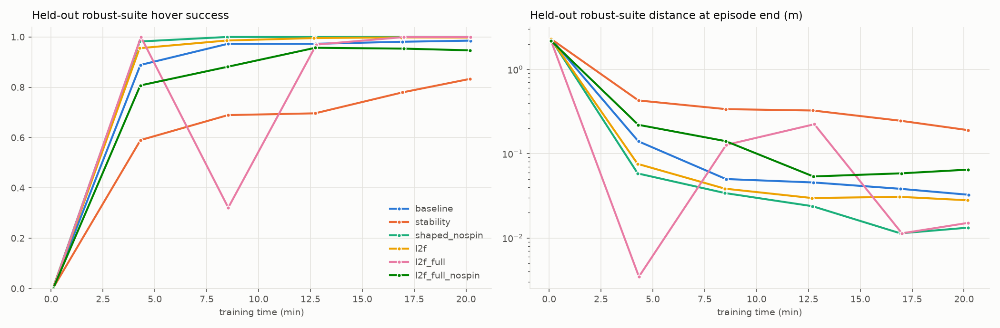
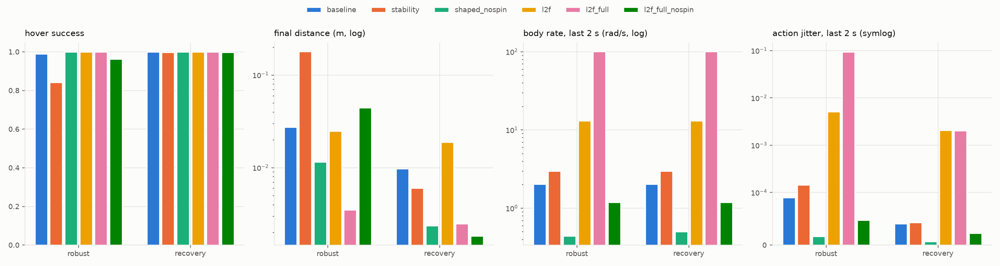

# Reward shaping and curriculum experiments

Everything here is switchable from [configs/variants.yaml](configs/variants.yaml); no code changes are needed to add
a variant. All variants share the physics, the three task stages (hover → reach → robust) and the held-out tests,
so differences come from the reward, the reward curriculum, and what the policy and critic observe.

## What can be varied

| knob | where | what it does |
|---|---|---|
| shaped reward weights | `env.rewards` | distance, precision, velocity (stronger near the target), body rate, tilt, effort, action rate, success bonus, crash |
| **unstable-flight penalties** | `env.rewards.ang_acc`, `lin_acc` | penalise angular acceleration (attitude wobble, per 100 rad/s²) and linear acceleration (jerk, per 10 m/s²), squared |
| **L2F reward** | `env.reward_mode: l2f`, `env.l2f` | r = c − s·(C_p‖e‖² + C_q·sin²(tilt/2) + C_v‖v‖² + C_ω‖ω‖² + C_a‖a‖²), clipped at 0, from *Learning to Fly in Seconds* |
| **penalty curriculum** | `env.penalty_curriculum` | every N PPO updates multiply chosen weights by factors up to caps; optional `gate` = only while measured hover success ≥ gate |
| action history | `env.action_history` | last H actions in the observation (paper: 32) |
| asymmetric critic | `env.asymmetric_critic` | critic also sees disturbance force/torque, actuator state, height and distance |
| disturbances | `env.disturbance_force`, `disturbance_torque` | per-episode random constant force (fraction of weight) and torque (N·m), training only |
| motor lag | `env.motor_tau` | first-order lag on thrust and torques (s) |

The L2F constants come from the paper's code ([arplaboratory/learning-to-fly](https://github.com/arplaboratory/learning-to-fly)):
initial weights `reward_squared_position_only_torque` (position 5, orientation 5, linear velocity 0.01, action 0.01,
scale 0.5, constant 2), curriculum in `src/steps/curriculum.h` (every 100k steps: position ×1.2 up to 40, linear
velocity ×1.4 up to 1, action ×1.4 up to 1). The paper's ablation found that without the curriculum "the policies are
not able to fly early on" (1/10 vs 10/10 real-world flights at 300k steps). Differences from the paper here: PPO
instead of TD3; the curriculum step is every 20 PPO updates (~2M transitions) and gated on hover success; tilt-only
orientation cost because heading does not matter for this task; rewards clipped at zero and a crash penalty, because
this task's targets can start up to ~1.4 m away and a negative per-step reward would otherwise make crashing early
the best option.

## Metrics

Every evaluation runs 1,024 fixed episodes per suite: **hover**, **reach**, **robust** (the training stages) and
**recovery**, which is never trained on (start tilted up to 45°, moving up to 1 m/s and 1 rad/s). Besides hover
success, crash rate and distance, the stability columns average the last 2 s of each non-failed episode:
body rate |ω|, wobble |dω/dt|, action jitter |a_t − a_{t−1}|, and the largest tilt in the episode.

## Running

```bash
python scripts/train.py --variant stability --budget_min 20 --out outputs/exp/stability/train
python scripts/evaluate.py --checkpoint outputs/exp/stability/train/checkpoints/best.pt --policies ppo \
    --out outputs/exp/stability/eval.json
python scripts/compare_experiments.py --exp outputs/exp --out outputs/exp/report
# on the cluster, one job per variant:
VARIANT=stability sbatch --export=ALL cluster/experiment.sbatch
```

## Results

Six variants, 20 minutes each on one DGX Spark GPU (4,096 drones, 2,190–2,450 PPO updates, ~215–240 M steps),
**one seed each**. Held-out test set (seed 2000), 1,024 episodes per suite, deterministic policy. Full tables for
all four suites: [outputs/exp/report/comparison.md](outputs/exp/report/comparison.md).

| variant | robust: success / crash | robust: distance at end | recovery (never trained on): success | body rate while hovering |
|---|---|---|---|---|
| baseline (shaped reward) | 99.0% / 1.0% | 2.7 cm | 100.0% | 2.0 rad/s |
| stability (+ wobble, jerk, action-rate, tilt penalties) | 84.3% / 15.7% | 18.0 cm | 99.7% | 3.0 rad/s |
| **shaped_nospin** (+ body-rate penalty) | **100.0% / 0.0%** | **1.2 cm** | **100.0%** | **0.4–0.5 rad/s** |
| l2f (paper reward + penalty curriculum) | 100.0% / 0.0% | 2.5 cm | 100.0% | 13 rad/s |
| l2f_full (+ action history, asymmetric critic, disturbances) | 100.0% / 0.0% | 0.3 cm | 100.0% | **101 rad/s** |
| l2f_full_nospin (+ angular-velocity weight 0.05) | 96.4% / 3.6% | 4.5 cm | 99.7% | 1.2 rad/s |
| PD controller (reference) | 100.0% / 0.0% | 2.6 cm | 100.0% | 0 |




What came out of it:

1. **Every first-round policy hovered while spinning about its thrust axis.** Yaw rate equals body rate in every
   row, so the spin is pure yaw. Nothing in those rewards charged for it: the shaped reward's body-rate weight was
   0.01, and the L2F angular-velocity weight is 0, as in the paper's code. The paper avoids the problem through its
   orientation cost, 1 − q_w², which also charges for heading changes; the tilt-only version used here (see above)
   removed that, so spinning became free. l2f_full took this furthest, at 101 rad/s (~16 revolutions per second), while being the most precise
   variant (0.3 cm). Success rate and distance alone would have ranked it best; the spin only showed up in the
   stability columns.
2. **A body-rate penalty removes the spin without costing accuracy.** shaped_nospin is the best variant overall:
   100% on all four suites, 1.2 cm on robust, 0.2 cm on recovery, 0.4–0.5 rad/s. The cost is slower settling
   (robust time to hover 1.05 s vs 0.73 s for baseline). The same fix on l2f_full dropped the spin to 1.2 rad/s
   but robust success fell from 100% to 96.4%.
3. **More unstable-flight penalties at once hurt.** The stability variant learned slowest and finished worst
   (84.3% robust, 15.7% crashes): heavier tilt, action-rate, wobble and jerk penalties together appear to stop it
   from making the aggressive corrections the robust suite needs.
4. **The L2F curriculum matched the shaped reward on success** (l2f 100% vs baseline 99.0% on robust, similar
   distance) with no reward tuning beyond the paper's constants. l2f_full's held-out success dipped to 32% at
   minute 8 before recovering; the cause was not investigated.

Caveats: one seed per variant, so differences of a few percent (96.4% vs 100%, 99.0% vs 100%) are within what
seed-to-seed variation could produce; that variation was not measured. The 60-minute main run in the README
used the baseline reward.

Next: rerun shaped_nospin and l2f_full_nospin with 3+ seeds; try l2f_full with the paper's full-quaternion
orientation cost instead of an angular-velocity penalty; and run l2f_motor_lag, which has not been run yet.
