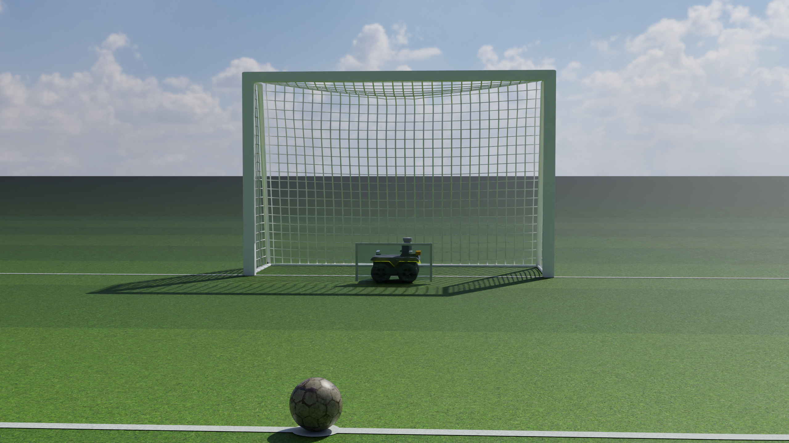

# PPO Goalkeeper

A Clearpath Jackal with a blocking panel learns to save rolling penalty shots in NVIDIA Isaac Sim, trained with
Proximal Policy Optimization written from scratch in PyTorch. The environment uses Isaac Lab's direct workflow
with 1,024 parallel keepers on one GPU.



## Results (60-minute run, held-out test shots)

One run on one DGX Spark GPU: 1,024 parallel keepers, 60.2 min of training, 91 M environment steps, 2,788 PPO
updates; the curriculum reached the advanced level in the first minutes. `best.pt` was picked on a held-out selection
set; these numbers come from a separate test set (seed 2000), 1,024 shots per level, deterministic policy.
Save rate counts on-target shots only.

| keeper | beginner | intermediate | advanced (5–8 m/s, noise, latency) |
|---|---|---|---|
| **PPO** | **100.0%** | **99.9%** | **99.0%** |
| analytical (predicts the crossing point, brakes optimally) | 100.0% | 100.0% | 98.9% |
| random actions | 64.8% | 54.2% | 38.0% |

On advanced shots, 95% are physically reachable from the keeper's start; the analytical keeper saves all of those.
PPO matches it. Untrained, the policy saved 88.9% / 52.1% / 40.9% (its first held-out evaluation; a keeper that barely moves still blocks central shots). Rendered playback of 10
advanced shots: PPO 10/10, analytical 10/10, random 4/10 ([play_summary_advanced.json](outputs/logs/play_summary_advanced.json)).

Plots: [save_rate.png](outputs/plots/save_rate.png), [eval_save_rates.png](outputs/plots/eval_save_rates.png),
[training_diagnostics.png](outputs/plots/training_diagnostics.png). Logs: [verify.json](outputs/logs/verify.json)
(physics checks and baselines), [metrics.csv](outputs/logs/metrics.csv), [eval_results.md](outputs/logs/eval_results.md).

Notes on what went wrong along the way, for anyone extending this: the Jackal asset ships with wheel friction 0.2 and
its wheel colliders lose contact against a very large box ground, so the keeper first sank and skidded (fixed with an
infinite ground plane and rubber-on-turf friction 0.9/0.85); and on the original 4–6 m/s "advanced" shots both PPO
and the analytical keeper saved 100%, so that level was made harder (5–8 m/s, keeper start ±0.8 m).

## The setup

| | |
|---|---|
| Simulator | Isaac Sim 5.1 + Isaac Lab 2.3.2 (direct workflow), GPU PhysX, 120 Hz physics, 30 Hz control |
| Hardware | NVIDIA DGX Spark (GB10, aarch64), Georgia Tech Futurama cluster |
| Pitch | futsal dimensions: 3 m x 2 m goal, penalty mark 6 m out |
| Keeper | NVIDIA's Clearpath Jackal asset (21.8 kg with panel), four velocity-driven wheels moving it through tyre friction; a 0.74 m x 0.40 m panel on a fixed joint |
| Ball | size-5 football, 0.43 kg, hollow-shell inertia, launched rolling (spin matched to speed) |
| Observation | 9 numbers: ball position/velocity, keeper position/velocity, relative position, previous action |
| Action | 1 number in [-1, 1]: requested sideways speed, through a speed-, acceleration- and travel-limited drive |
| Reward | +10 save, -10 goal, potential-based shaping toward the interception point, small action/jerk penalties |
| PPO | separate actor/critic MLPs [128, 128], GAE (γ 0.99, λ 0.95), clip 0.2, 4 epochs x 4 minibatches, lr 3e-4 |

Outcomes are kept separate: **goal** (ball wholly over the line between the posts), **save** (keeper touched it
and it did not go in), **miss** (wide or off the post without a touch), **timeout**. Save rates are computed over
on-target shots only; wide shots never count as saves.

### Shot curriculum (promotion at 85% on-target save rate over 2,048 episodes)

| level | speed | aim (on the goal line) | keeper start | extras |
|---|---|---|---|---|
| beginner | 3-4 m/s | within 0.6 m of centre | centre | |
| intermediate | 3.5-5.5 m/s | within 1.0 m | within 0.3 m | |
| advanced | 5-8 m/s | within 1.35 m (+10% wide shots) | within 0.8 m | observation noise (2 cm, 0.1 m/s), 33 ms actuation latency on half the shots |

## Repository layout

```text
ppo-goalkeeper/
├── PPO_EXPLAINED.md            how PPO works here, with pointers into the code
├── configs/train.yaml          environment, reward, curriculum and PPO settings
├── assets/ATTRIBUTION.md       open-licence assets and their licences
├── goalkeeper/
│   ├── environments/           Isaac Lab env, asset builder, render-only field dressing, evaluation
│   ├── robots/keeper.py        Jackal + blocking panel
│   ├── physics/                field geometry, shots, outcome rules, drive limits, rewards, observation
│   ├── controllers/            analytical and random baselines
│   ├── rl/                     networks, PPO, GAE, rollout buffer, curriculum (no RL library)
│   └── visualization/          cameras, RTX capture, plots
├── scripts/                    verify_env, capture_screenshot, train, evaluate, play, make_plots
├── tests/                      PPO math and game-logic unit tests (CPU)
├── cluster/                    Slurm jobs for the DGX Spark nodes
└── outputs/                    screenshots, checkpoints, logs, plots, videos
```

## Running it

Isaac Sim 5.1 needs Linux with glibc 2.35+ and an RTX-class NVIDIA GPU. `cluster/common.sh` shows the exact
install (Python 3.11, `isaacsim[all,extscache]==5.1.0`, torch 2.9.0 cu130 on aarch64, Isaac Lab v2.3.2 from source,
numpy 1.26.4).

```bash
python -m pytest -q tests                                   # PPO math + game logic, CPU, ~10 s
python scripts/verify_env.py                                # physics checks + random/still/analytical baselines
python scripts/capture_screenshot.py                        # 2560x1440 path-traced stills
python scripts/train.py --budget_min 60 --out outputs/run   # headless PPO, stops at the budget
python scripts/train.py --resume outputs/run/checkpoints/latest.pt --out outputs/run
python scripts/evaluate.py --checkpoint outputs/run/checkpoints/best.pt
python scripts/make_plots.py --run outputs/run
python scripts/play.py --checkpoint outputs/run/checkpoints/best.pt --policies ppo,analytical,random
python scripts/play.py --checkpoint outputs/run/checkpoints/best.pt --gui --realtime   # with a display
```

On the Futurama cluster everything runs as one job, in order (verify, screenshot, smoke test, training,
evaluation, plots, playback): `sbatch cluster/pipeline.sbatch`.
